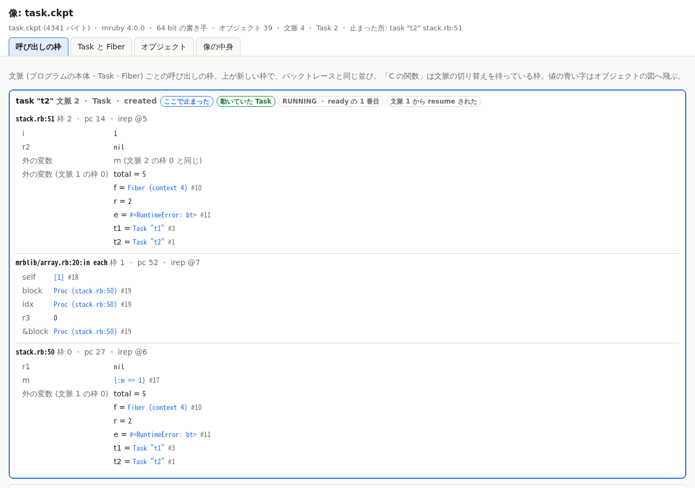
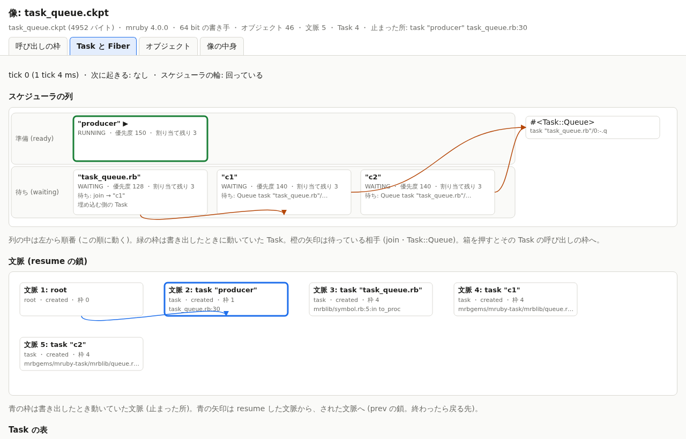
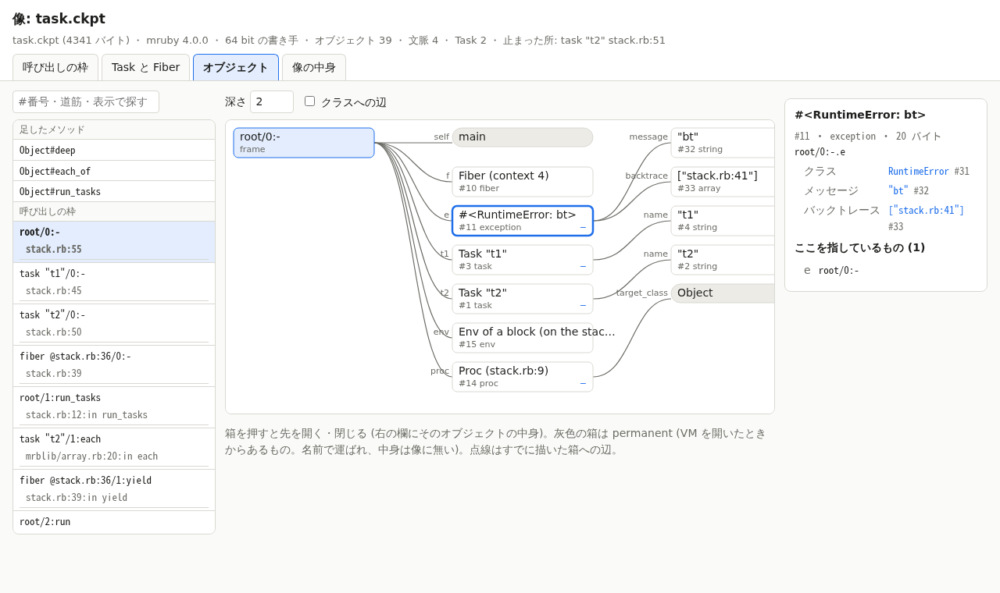
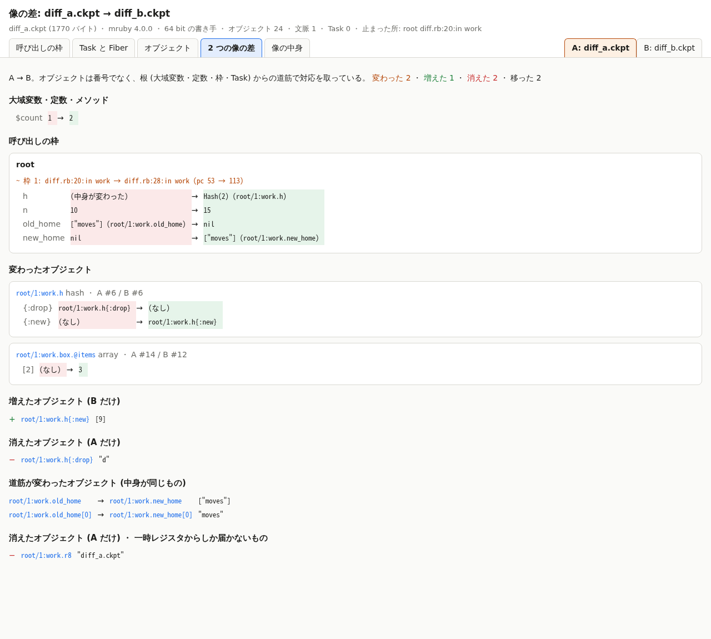

# P5 報告: 像の可視化 (共通の読み手、CLI、HTML)

> 状態: 実装済・検収待ち | 更新: 2026-11-03 | 指示は `doc/instruction_p5.md`

## 結果

- **読み手は 1 つ** (`tools/lib/checkpoint_image.rb`、Ruby の標準ライブラリだけ)。像 (v1) の全部の節を
  読み、JSON (inspect JSON 版 1、`doc/inspect_json.md`) にする。CLI・HTML・差は全部この JSON から作る。
  元の `tools/checkpoint_inspect.rb` (形式の文書だけから書いた 2 つ目の読み手) は、この読み手の上の
  CLI に置き換えた。C の側・形式・SabiRuby は変えていない。
- JSON は「像のままの欄」と「導いた欄」を持つ。導いた欄は、枠ごとの `file:line`・局所変数・
  ブロックが見ている外の変数、文脈ごとのバックトレース (mruby の `backtrace.c` と同じ規則)、
  オブジェクトの短い表示・図の辺・根からの道筋、Task と文脈の像をまたぐ名前 (`key`)。
- **CLI**: 全部の記録 (従来の出力)、`--stack`、`--objects [--depth N] [--from 道筋|#番号]`、`--tasks`、
  `--json`、`--html out.html`、`diff a b [--json|--html]`。
- **HTML**: 1 ファイル (外の資源を読まない。素の DOM と SVG と JavaScript)。表示は 5 つ: 呼び出しの枠、
  Task と Fiber、オブジェクトの図、2 つの像の差、像の中身 (表の大きさ・節・irep)。
- **差**はオブジェクトの番号でなく根からの道筋で対応を取る。`save` を 2 回した像の差は、
  プログラムがその間に変えたものだけになる (試験で全部の行を照合)。
- **試験** (`tools/test_inspect.rb`、`rake test` の中): 2973 の検査がすべて通る。`rake test` 全体も
  通る (SabiRuby の部分は、この環境に SabiRuby の実行ファイルが無いので従来どおり飛ばした)。
  - サンプルの像 168 個 (2 つの起動の形 × 64・32 bit × 中断の鎖) を読み、JSON の形・irep の
    ハッシュ・表示・自分自身との差なしを確かめる。同じ点の 64 bit と 32 bit の像の差は、書き手の
    ポインタ幅だけになる。
  - `--stack` の行が、同じ点で上げた例外の mruby のバックトレースと一致する (動いていた文脈と、
    待っていた文脈の両方。2 つの起動の形 × 64・32 bit)。
  - 壊れた像: 全部のバイト位置で切った像 8836 個は、どれも場所つきで断る。1 バイト変えた像
    2520 個は、場所つきで断るか、読めたものは表示まで通る (それ以外の例外は 0)。
  - HTML: 埋め込んだ JSON が読み戻せ、外を読みに行かない。ヘッドレスの Chromium (Playwright が
    手元に置いていたもの。何も入れていない) で 5 つの表示が描け、スクリプトの不具合が出ない。

## 作ったもの

| ファイル | 中身 |
|---|---|
| `tools/lib/checkpoint_image.rb` | 読み手 (像 → JSON)。壊れた像の場所、知らない節の 16 進の要約 |
| `tools/lib/checkpoint_derive.rb` | 導いた欄 (行、局所変数、バックトレース、表示、辺、道筋) |
| `tools/lib/checkpoint_text.rb` | 文字の表示 (全部の記録、`--stack`、`--objects`、`--tasks`) |
| `tools/lib/checkpoint_diff.rb` | 2 つの像の差 (JSON と文字) |
| `tools/lib/checkpoint_html.rb`、`tools/lib/inspect_html/app.js`・`style.css` | 1 ファイルの HTML |
| `tools/lib/checkpoint_schema.rb` | JSON の形をデータで書いたものと、その検査 |
| `tools/checkpoint_inspect.rb` | CLI |
| `tools/test_inspect.rb`、`test/inspect/stack.rb`・`diff.rb`・`diff_task.rb` | 試験 |
| `doc/inspect_json.md` | JSON の文書 (GUI の側はこれだけで作れるように) |

## 読み手

- 記録はすべて形式どおりの順に読み、知らない種類・タグ、表の外を指す番号、長さの足りない記録、
  `END0` の後の余りで止まる。止まった所は、バイト位置と記録の場所 (`objects > #12 (hash)`、
  `contexts > 2 > frame 3` など) で言う。
- 参照が指す先の種類も確かめる (Proc の環境が Env か、枠の Proc が Proc か、Task の表の
  オブジェクトが Task か、変更表の対象が permanent か、など)。そこまで確かめておけば、導いた欄の
  計算は落ちない (1 バイト変えた像 2520 個で、導いた欄で落ちたものは 0)。それでも合わなければ
  `derived fields` の場所で止まる。
- 運ぶ irep は中身からハッシュを計算し直し、合わなければ注意に出す (`hash_ok`)。運び方の不具合を
  調べるときに、どの irep が壊れたかが分かる。
- 知らない節は、形式が節に長さを持たせていないので、その印から最後の `END0` の手前までを中身と
  みなし、先頭 64 バイトの 16 進で残す (注意にも出す)。
- 名前 (シンボル・ファイル名) で UTF-8 でないバイトは `\xHH` と書く (JSON に載せるため)。
  文字列の中身は `text` か `hex`。

## 見せ方の判断

画面 (`build/inspect/` に作ったページをヘッドレスの Chromium で撮ったもの):

- 呼び出しの枠 (`test/inspect/stack.rb` の Task の中の点):

  

- Task と Fiber (`test/samples/task_queue.rb` を Task の形で。Queue を待つ Task、join を待つ
  埋め込む側の Task):

  

- オブジェクトの図 (起点は本体の一番外の枠。例外を選んだところ):

  

- 2 つの像の差 (`test/inspect/diff.rb`):

  

判断したこと:

- **呼び出しの枠**: 文脈ごとのカードに、上の枠から (バックトレースと同じ並び) 並べる。止まった
  文脈を先頭にする。行はバックトレースの 1 行の形 (`file:line:in method`) にそろえ、mruby が
  バックトレースに出さない枠 (行の無い枠) は印を付けて出す。C の関数の枠 (`Fiber#resume`・
  `Task.run` などで待っているもの) は名前つきで出す。局所変数のほかに、ブロックが見ている外の
  変数を出す (同じ文脈の枠のレジスタそのものなら「どの枠と同じか」だけ、別の文脈か切り離した
  Env なら値も)。`self` は main 以外のとき出す。
- **オブジェクトの図**: 全部は描かない。起点 (既定は止まった枠。左の一覧で根を選ぶか、番号・
  道筋・表示で探す) から深さ 2 まで開き、箱を押すと先を開く・閉じる。1 つの箱から出る辺は 40 本で
  切り、残りは「あと N 個」の箱 (押すとそこを起点にする)。permanent は名前だけの灰色の印にして、
  先を開かない。クラスへの辺は既定で隠す (どの箱からも出て図が埋まるため)。すでに描いた箱への辺は
  点線。右の欄に中身と「ここを指しているもの」を出す。
- **Task と Fiber**: スケジューラの列を横の帯にし、列の中を動く順に並べる。箱に状態・優先度・
  割り当ての残り・待ちの理由と残りの tick を書く。動いていた Task は緑の枠。待ちの相手 (join の
  Task、Task::Queue) へ矢印。その下に文脈の図 (resume の鎖 `prev` を矢印、止まった文脈を青の枠) と
  Task の表。箱を押すと、その Task の呼び出しの枠へ飛ぶ。
- **差**: 大域変数・定数・メソッド、枠 (下から同じコードの間を対応させ、行・局所変数の違い、
  増えた枠・戻った枠)、Task、スケジューラ、オブジェクト (変わった・増えた・消えた・移った) の順。
  一時レジスタからしか届かないオブジェクトは別の見出しにする (命令ごとに変わり、目当ての差を
  埋めるため。`Checkpoint.save` の引数の文字列などがこれに当たる)。
- **像の中身**: ヘッダ、種類ごとの数とバイト数、節、irep の表 (ハッシュの照合の結果つき)。運ぶ量の
  内訳を見るため。
- ページの言葉は日本語。表示の切り替えは URL の `#view=...` に残す (リンクやヘッドレスのブラウザ
  から 1 つの表示を直接開ける)。明るい・暗い配色の両方。幅 420 px でも崩れない (端末のブラウザ用)。

## 差の対応の付け方

- 根の順: 大域変数 → permanent なクラスの定数・ivar → 足したメソッド → 枠 (どの文脈も一番外の
  枠から) → Task → Fiber。各オブジェクトに、根から幅優先で最初に届いた道筋を付ける
  (`root/1:work.box.@items`)。変数でない一時レジスタは最後に回す。外の枠ほど長く生きるので、
  そこを通る道筋の方が 2 つの像の間で変わりにくい。
- 同じ道筋・同じ種類なら同じオブジェクトとみなし、欄を比べる (参照は相手の道筋で比べる)。
  片方にだけある道筋のうち、中身が同じで、その中身が両方に 1 つずつしか無いものは「移った」と
  する (別の変数に移っただけのもの)。
- 文脈は `root`・`task "名前"`・`fiber @本体の場所`、Task は名前 (無ければ本体の場所) で対応させる。
- 限界 (`doc/inspect_json.md` §9): 道筋が変わり中身も変わったものは消えた + 増えたに見える。
  近い経路ができる・消えると道筋が変わる。Hash のオブジェクトの鍵は並びの位置に依る。枠は途中が
  入れ替わるとそこから上は全部入れ替わりに見える。同じ場所から作った名前の無い Task が複数あると
  表の順で対応させる。

## 大きい像での速さと大きさ

この PC (WSL2) で測った。読む + JSON は CLI の `--json` を最後まで。HTML を開くのはヘッドレスの
Chromium の `--dump-dom` が終わるまで (JSON の解析と最初の表示)。

| 像 | 像のバイト | オブジェクト | 読む + JSON | JSON | HTML | HTML を開く |
|---|---|---|---|---|---|---|
| サンプルで最大 (`fiber_generator`) | 5.8 KB | 48 | 0.08 秒 | 38 KB | 83 KB | 0.11 秒 |
| mruby の試験一式の途中 (`core/hash.rb`、枠 18・irep 273) | 86 KB | 239 | 0.09 秒 | 297 KB | 305 KB | 0.13 秒 |
| 作った大きな像 (文字列と Hash) | 45 KB | 2,008 | 0.08 秒 | 439 KB | 485 KB | 0.14 秒 |
| 同 | 458 KB | 20,008 | 0.23 秒 | 4.5 MB | 4.6 MB | 0.55 秒 |
| 同 | 2.35 MB | 100,008 | 0.88 秒 (230 MB) | 23 MB | 23 MB | 2.5 秒 |

- JSON は像の約 10 倍になる。オブジェクト 1 つにつき、導いた欄 (道筋・表示・辺) が 100〜150
  バイト足される。道筋は深い入れ子ほど長い。命令列 (`iseq`) は HTML には入れない (表示に使わない)。
  ページの JavaScript と CSS は約 46 KB。
- Family mruby のアプリの像は数 KB〜数十 KB の見込み (試験一式の途中でも 86 KB) なので、HTML は
  1 MB を超えない。10 万オブジェクトでも開けるが、端末のブラウザには重い (GUI の側の課題、下)。

## 試験の数字

| 部分 | 中身 | 検査の数 |
|---|---|---|
| サンプルの像 | 168 個 (441 KB): 読める・JSON の形 (命令列あり・なし)・ハッシュ・注意なし・往復・表示・自分との差なし・差の JSON の形、64 → 32 はポインタ幅だけ | 1474 |
| 枠 = バックトレース | `stack.rb` の 6 点 × 2 つの起動の形 × 64・32 bit (動いていた文脈 4 点、待っていた文脈 2 点、`--stack` の文字も) | 48 |
| 2 回の save の差 | `diff.rb` (局所変数・Hash・ivar の Array・大域変数・移ったもの)、`diff_task.rb` (時計・sleep の残り・別の Task のブロックの局所変数) × 2 つの起動の形 × 64→64・32→32・64→32、CLI の `--json` と同じ像どうし | 40 |
| 壊れた像 | 切った像 8836 個 (すべて断ることを確かめる。失敗のときだけ数える)、1 バイト変えた像 2520 個 (うち 1390 個は形として正しく読め、表示まで通る)、知らない節、`END0` の後の余り、CLI の終了の値と場所の文 | 1394 |
| HTML | 2 つのページ (像 1 つ、差)、書き出せる、埋め込みの JSON の読み戻し、外を読まない、ヘッドレスのブラウザで 9 表示 | 17 |

`rake test` 全体の時間は約 30 秒 (この試験は約 7 秒)。ヘッドレスのブラウザは、
`CHECKPOINT_CHROME` か Playwright の置き場所 (`~/.cache/ms-playwright`) にあれば使い、無ければ
飛ばしたことを出す。

## サブの仮決め

1. **知らない節は最後の `END0` の手前までを中身とみなす**。形式の節に長さが無いため。形式 §13 は
   「知らない印は断る」だが、見る道具は断らずに 16 進で残し、注意に出す (指示どおり)。後ろに
   知っている節があっても、その中に入ってしまう。形式に長さを足せば正しく飛ばせるが、形式は
   変えない約束なので触っていない (決めてほしいこと 4)。
2. **値の JSON の表し方** (`null`・数・`{"int"}`・`{"float"}`・`{"sym"}`・`{"ref"}`・`{"undef"}`)。
   小さい形を選んだ (像の 10 倍の大きさのうち、値の量が大きい)。2^53 を超える Integer は文字列に
   する (JavaScript の数で丸まるため)。
3. **導いた欄も同じ JSON に入れる** (別のファイルにしない)。GUI の側が形式を知らずに描けることを
   優先した。像のままの欄は全部残すので、導いた欄は捨てて計算し直してもよい。
4. **道筋の根の順と一時レジスタの後回し**、**文脈・Task の `key`** (上の「差の対応の付け方」)。
5. **「移った」の対応は、中身が同じものが両方に 1 つずつのときだけ**。2 つ以上あると取り違える
   ので対応させない。
6. **読み手は参照の先の種類まで確かめる** (C の読み手が復元で断るものと同じ程度)。像としては
   読めるが復元で断られるものも、ここで「壊れている」と言う。
7. **元の `tools/checkpoint_inspect.rb` の出力は、引数なしのときの全部の記録として残した**。最後の
   行は従来どおり `end` で、`tools/run_tests.rb` の「像が読めるか」の検査はそのまま使える。
   ファイル名は同じで、中身は新しい読み手の上の CLI。形式の文書だけから書いた 2 つ目の読み手という
   役目は、新しい読み手が引き継ぐ (やはり形式の文書だけから書いた)。
8. **HTML には命令列を入れない** (`omitted: ["ireps.iseq"]`)。表示に使わず、大きさだけ増えるため。
9. **無名の局所変数は `r番号` で出す** (無名のレジスタも像の中身なので隠さない)。
10. **ページの言葉は日本語、道筋と辺の名前は英語のまま** (道筋は CLI と JSON と同じ文字列にする)。
11. **画面の PNG 4 枚 (約 470 KB) を `doc/report/p5/` に入れた**。像はサンプルの像で、道筋や名前に
    手元の場所は出ていない。
12. **試験の `stack.rb`・`diff_task.rb` は仮想の時計で動かす** (Task の切り替えを毎回同じにするため)。
    サンプルの像は、サンプルの注記どおり (仮想の時計の印があるものだけ仮想)。
13. **HTML の不具合はページに出す** (`id="js-error"` の箱)。ヘッドレスの検査はこれを見る。

## GUI に進むときに要るもの

- **像の取り寄せ**: GUI は像のファイル (または JSON) を受け取る口が要る。console なら Asterism の
  キーで像を流す、端末のアプリならファイルとして読む。読み手は CRuby の標準ライブラリで書いて
  いる (`unpack1` の `offset:`、`json`)。端末 (mruby / PicoRuby) で動かすなら、読み手を移すより、
  PC か console で JSON にして端末へ送る方が軽い。
- **HTML の JavaScript はそのまま土台になる**: 入力は `doc/inspect_json.md` の JSON だけで、外の
  ライブラリを使っていない。console のページに埋めるなら、`checkpoint-data` の要素の代わりに
  受け取った JSON を渡せばよい。
- **ソースの行**: 像はソースを持たないので、行の中身は出せない。GUI でソースを見せるなら、ファイル名
  (`file`) から取りに行く口が要る (端末のファイル、または開発の PC)。
- **命令の位置**: 行の中のどの命令で止まったか (pc) は数でしか出していない。逆アセンブルを足すなら
  読み手の導いた欄に足す (命令表は RITE 04.00)。
- **大きなヒープ**: JSON は像の 10 倍。10 万オブジェクトで 23 MB。端末で見るなら、オブジェクトを
  必要な分だけ取り寄せる形 (根と枠だけを先に送り、図を開くたびに中身を頼む) が要る。導いた欄は
  オブジェクトごとに閉じているので、分けて送れる。
- **続けて見る**: 像を次々に受け取って直前との差を出すのは、今の `diff` でできる (デモで、ボードを
  渡るたびに何が変わったかを見せる材料になる)。

## 決めてほしいこと

1. **GUI の置き場所** (Asterism の console か端末のアプリか)。P5 の後で決める予定のとおり。上の
   「GUI に進むときに要るもの」が材料。
2. **ページの言葉**: 日本語にした。デモ (Ghost) で英語の聞き手に見せるなら、言葉の表を分けて
   切り替えられるようにする。
3. **報告の画面の PNG を git に入れること** (約 470 KB)。重ければ外して、作り方 (コマンド) だけ残す。
4. **知らない節の扱い** (サブの仮決め 1): 形式の任意の節に長さを持たせれば、見る道具も復元する側も
   知らない節を正しく飛ばせる (後から節を足しても古い読み手が読める)。形式の変更なので、P5 では
   していない。v1 のまま (外に読み手が少ないうち) に足すか、足さないか。
5. **同じプロセスの 2 回の save の差を正確にするか**: いまは道筋で対応させるので限界がある (§差の
   対応の付け方)。書く側が任意の節でオブジェクトの同一性 (同じプロセスの中で変わらない番号) を
   書けば、同じプロセスで続けて書いた像どうしは正確に対応できる。形式に節を足すことになるので、
   要るかどうか。
